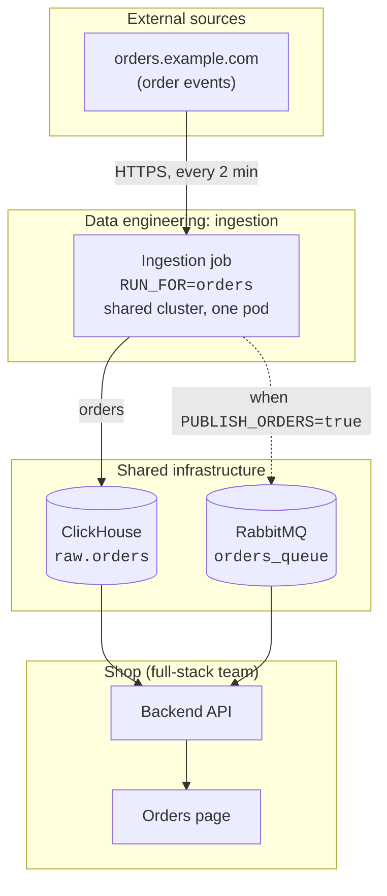

# Diagrams

Read this file when you draw a diagram of a system or a data flow, or when you edit a document that has one. It gives the house style: a Mermaid flowchart with the parts grouped by owner, and a table and notes under it for the facts a picture can't hold.

A project that already draws its diagrams another way keeps its way.

## Contents

- [When to draw one](#when-to-draw-one)
- [Template](#template)
- [Groups](#groups)
- [Nodes](#nodes)
- [Edges](#edges)
- [Overview first, then detail](#overview-first-then-detail)
- [What goes around the diagram](#what-goes-around-the-diagram)
- [Current and target](#current-and-target)
- [Labels that Mermaid misreads](#labels-that-mermaid-misreads)
- [Check the render](#check-the-render)

## When to draw one

- Draw a diagram when the reader needs to see which parts exist, who owns them, and what moves between them. Prose handles that badly once there are more than four or five parts.
- Don't draw one for steps in order (use a numbered list), for a comparison (use a table), or for a decision and its reasons (use paragraphs).
- Give each diagram one question to answer. "How does an order reach the Orders page?" is one question. "What happens inside the service?" is another, and it gets its own diagram.
- Write the diagram as a `mermaid` code block in the Markdown file. GitLab and GitHub render it, and a change to it shows in a diff.

## Template

Use `flowchart TD`: sources at the top, and the people or pages that use the data at the bottom.

````markdown

````

## Groups

A group is a `subgraph`. It answers "who runs this?".

- Make one group for each owner or boundary. Put a part in the group of the team that runs it, which is not always the team that wrote it.
- Title a group with the owner, then the role: "Data engineering: ingestion". When the reader knows the system better than the team, name the system, then the team: "Shop (full-stack team)". Use "External sources" and "Shared infrastructure" for the parts that no team in the document owns.
- Keep a title under about 25 characters, and no wider than the widest node in its group. A longer title wraps onto a second line, and the first node in the group covers that line.
- Declare the groups in the order of the flow, top to bottom.
- Don't put a source and a destination in the same group. The group then stretches over the whole height of the diagram, and every other group is pushed to the side.
- Nest a group one level at most, and only for a real boundary: one pod, one process.

## Nodes

- Give each node a short lowercase id with no punctuation: `service`, `clickhouse`, `poller`.
- Quote every label. An unquoted label that holds a parenthesis is a parse error.
- Put the name the team uses on the first line. On the next lines, put what identifies the part: its repository or file, the setting that selects it, where it runs. Break lines with `<br/>`, and stop at three lines.
- Use `<code>` for anything literal: a table, a queue, a file, an environment variable.
- Use two shapes. A rectangle, `["…"]`, is something that runs: a service, a job, a consumer, a page. A cylinder, `[("…")]`, is something that holds data: a database, a queue, a cache.
- When a part is temporary, say until when in its label: "(until the new queue is live)".
- Keep a diagram to about 15 nodes. Past that, split it into an overview and a detail diagram.

## Edges

- Point the arrow the way the data moves, not the way the call goes. A poller that calls an API every 2 minutes is drawn as API to poller, because the data ends up in the poller.
- Use a solid arrow, `-->`, for a flow that always happens.
- Use a dotted arrow, `-.->`, for a flow that is conditional, temporary, or a read-back. Give the condition in the label: "when switched on".
- Label an edge when the reader can't guess what moves. Say what it carries ("orders, refunds"), how and how often ("HTTPS, every 2 min"), or under which condition. Write the label in lowercase with no period, and break a long one with `<br/>`.
- Write all the edges after all the groups, in the order of the flow.
- Use no colors, no `classDef`, no `style`, and no icons. The default theme follows the reader's light or dark mode, and nothing in the diagram should depend on color.
- Fix the layout last, after you have seen the render. An invisible link, `a ~~~ b`, puts two nodes side by side. A longer arrow, `--->`, pushes a node one rank down. When two groups sit side by side and make the diagram too wide, a longer arrow into one of them puts it under the other.

## Overview first, then detail

- The first diagram shows the whole system: one node for each deployed part, in groups by owner.
- A part that needs more gets its own diagram under its own heading. There, the nodes are the components inside one pod or process, with their files.
- Call a part by the same name in both diagrams.

## What goes around the diagram

A diagram shows that parts exist and that they connect. It can't show where a part runs, what it does, or what goes wrong between two parts. Put those in text, in this order:

1. A sentence before the diagram that says what it shows.
2. The diagram.
3. A table of the parts, with one row for each part the reader could ask about:

   ```markdown
   | Part | Owner | Runs on | What it does |
   |---|---|---|---|
   ```

   Link the name of a part to its repository. Write an unknown as an unknown: "(not known yet: which broker each environment uses)".
4. Notes: a short list of the facts that surprise a newcomer and that no arrow can show. Examples: environments that share one data set, rows that are never deleted, a thing that appears twice. Write one fact per note, with the claim first and the cause after it.

## Current and target

- Draw the system as it is and the system as proposed in two diagrams, under two headings. Don't mark the changes with color in one diagram.
- In the second diagram, keep the ids, the labels, and the order of the parts that don't change. The reader then finds the difference by eye.
- Say in the heading or the first sentence how firm the target is: a draft, a proposal, or a decision, and who agreed to it.
- Mark a part that is still undecided in its label: "(keep or drop: open)".

## Labels that Mermaid misreads

Mermaid reads a quoted label as Markdown. In the first three cases below, the diagram still renders, and the node shows an error text in place of your label. A parse check alone doesn't catch them.

| Label | What the reader sees | Write this |
|---|---|---|
| Starts with `1. `, `- `, or `* ` | "Unsupported markdown: list" | "Stage 1: exact match" |
| Starts with `# ` | "Unsupported markdown: heading" | Start with a word |
| Holds `www.` or `https://`, even inside `<code>` | "Unsupported markdown: link" | The host without `www.`, with or without a path: `wikidata.org/w/api.php` |
| Not quoted, and holds `(` or `)` | No diagram: a parse error | Quote the label |
| A group title of more than about 25 characters, or wider than its group | The title wraps, and the first node covers its second line | Shorten the title |

These were checked on Mermaid 11.4.1 on 2026-11-11.

## Check the render

A diagram that parses can still be wrong: a label replaced by an error text, a title printed over a node, a layout that sends the reader's eye in circles. Render it and look at it before you hand it over.

Run the script from the skill's directory:

```bash
python3 scripts/render_mermaid.py <file.md> <out-dir>
```

Replace `<file.md>` with the Markdown file, and `<out-dir>` with a directory for the images, outside the project. The script renders each `mermaid` block with a local Chromium-based browser and prints one line for each block: `OK`, `PARSE ERROR`, or `BAD LABEL`. It writes one PNG for each block.

Then open each PNG and check four things:

- Every label reads as you wrote it.
- No group title covers a node.
- The flow reads from the top to the bottom, and few arrows cross.
- The diagram fits a page. An image much wider than about 1,500 px has too many nodes in one rank: split it.

The script needs network access, because it loads Mermaid from a CDN (content delivery network). GitLab and GitHub each pin their own Mermaid version, so the script is a check and not a guarantee. If you can't render the diagram, say so in your note to the user.
